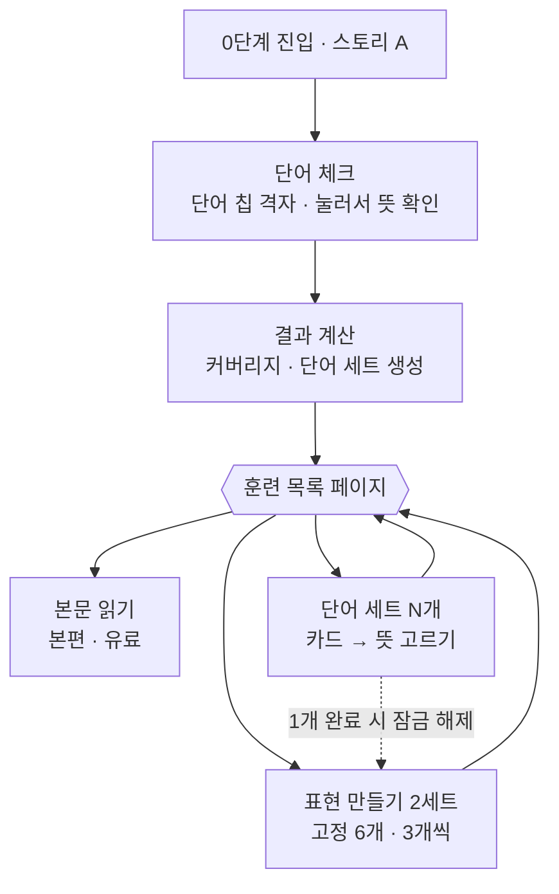

# 프로젝트 09 — 0단계 단어·표현 훈련 프로토타입

1단계 스토리가 어려운 학습자를 위한 0단계 흐름의 클릭 프로토타입입니다. 스토리에 나오는 단어 중 아는 단어를 체크하고, 커버리지(아는 단어 비율)에 따라 단어 세트와 표현 만들기 훈련을 제공합니다. 진입점은 원 콘텐츠와 분리된 별도 화면입니다.

예시 스토리 `민지의 아침`은 프로토타입용으로 만든 문장이며 실제 콘텐츠가 아닙니다. 기준값(85%, 세트당 5개, 표현 3개씩)도 예시입니다.

## 실행 방법

빌드나 설치가 필요 없습니다. `index.html`을 브라우저로 열면 됩니다.

- 왼쪽: 유저가 보는 폰 화면 (직접 눌러볼 수 있음)
- 오른쪽: 기획자 뷰 (유저에게 보이지 않음). 커버리지, 학습 계획, 원문의 단어 상태가 실시간으로 바뀝니다.
- 기획자 뷰 상단의 유저 유형 버튼으로 단어 체크를 건너뛰고 세 가지 경우를 바로 볼 수 있습니다.

| 유형 | 아는 단어 | 결과 |
|---|---|---|
| 초급자 · 단어 조금 부족 | 8개 (41%) | 단어 세트 2개 (5 + 6단어) |
| 중급자 · 바로 읽기 가능 | 21개 (91%) | 단어 세트 없음, 표현 만들기 바로 열림 |
| 입문자 · 단어 많이 부족 | 3개 (21%) | 단어 세트 3개 |

## 전체 흐름



1. **단어 체크**: 스토리의 모든 내용어를 칩 격자로 보여줍니다. 아는 단어를 누르면 뜻이 나오고, 생각한 뜻과 다르면 다시 눌러 해제합니다.
2. **훈련 목록 페이지**: 체크 후 바로 훈련으로 넘어가지 않고 이 페이지로 옵니다. 커버리지, 단어 세트 목록, 표현 만들기 2세트, 본문 읽기 버튼이 함께 보입니다.
3. **훈련**: 단어 세트와 표현 만들기는 각각 독립된 훈련입니다. 끝나면 항상 "본문 읽기 / 훈련 목록으로" 두 버튼이 나옵니다.

## 핵심 규칙

### 커버리지

`아는 단어들의 등장 횟수 합 ÷ 스토리 전체 단어 등장 수`. 같은 단어가 3번 나오면 3토큰으로 셉니다. 읽기 가능선은 85%입니다.

### 단어 세트 생성

1. 모르는 단어만 남깁니다. 아는 단어는 세트에 넣지 않습니다.
2. 등장 횟수가 많은 순으로 정렬합니다. 같으면 먼저 등장한 순입니다.
3. 위에서부터 등장 횟수를 더해 85%선에 도달하면 멈춥니다. 그 아래 단어는 "읽으며 익히기"로 넘겨 본문의 단어 탭으로 확인합니다.
4. 5개씩 묶습니다. 마지막 세트가 2개 이하이면 앞 세트에 합칩니다.

목표는 모르는 단어를 전부 배우는 것이 아니라, 읽을 수 있는 선까지만 배우는 것입니다.

### 훈련 목록 페이지

- 85% 이상이면 "본문 읽기"를, 85% 미만이면 훈련을 강조합니다. 선택지 자체는 같고 강조만 바뀝니다.
- 단어 세트는 순서와 상관없이 고를 수 있고, 끝낸 세트도 다시 할 수 있습니다.
- 표현 만들기는 단어 세트를 1개 이상 끝내면 열립니다. 단어 세트가 0개인 경우(이미 85% 이상)는 처음부터 열려 있습니다.

### 표현 만들기

- 스토리별 고정 목록(이 예시는 6개)을 3개씩 2세트로 나눕니다. 유저가 어떤 단어를 아는지와 무관하게 동작합니다.
- 원문에서 2~4어절 덩어리만 가져옵니다. 본편이 유료이므로 완전한 문장은 노출하지 않습니다.
- 영어 뜻을 보고 어절 타일을 순서대로 누릅니다. 오답 타일이 1개 섞여 있고, 모르는 단어는 "단어 뜻 보기"로 확인합니다.

## 데이터 (MVP 제안)

- 스토리별로 미리 준비하는 정적 데이터: 내용어 목록(원형, 뜻, 등장 횟수), 표현 목록(어절 타일, 구성 단어, 뜻).
- 유저 데이터는 기존 단어장 DB와 분리해 저장합니다: `user_id, word_id, story_id, source, updated_at`.
  - `word_id`는 기존 단어 DB와 같은 ID를 씁니다. 나중에 합칠 때 텍스트 매칭이 필요 없습니다.
  - `source`로 "체크에서 안다고 답함(`self_check`)"과 "0단계에서 학습 완료(`stage0_learned`)"를 구분합니다. 신뢰도가 다르기 때문입니다.
- 커버리지는 저장하지 않고 화면을 그릴 때마다 계산합니다.

## 고려할 점

- 실제 1단계 스토리는 내용어가 40~60개일 수 있어 체크 화면에 스크롤이 생깁니다. 등장 횟수 순 정렬이나, 커버리지 영향이 큰 상위 단어만 체크하는 방식을 검토할 수 있습니다.
- 단어 세트 개수에 상한이 없어서, 모르는 단어가 많은 유저는 세트가 길어집니다. 세트별 이탈 지점을 측정해야 합니다.
- 활용형(`먹었어요`)과 원형(`먹다`) 처리: 체크와 세트는 원형, 표현 만들기는 활용형을 씁니다.

## 폴더 구성

- `index.html` — 프로토타입 화면 (폰 화면 + 기획자 뷰). 브라우저로 바로 열립니다.
- `logic.js` — 예시 스토리 데이터, 커버리지·단어 세트·잠금 계산
- `tests/logic.test.cjs` — 계산 로직 테스트
- `canvas/` — Claude Design 캔버스 아티팩트 원본. 수정 없이 그대로 보관한 파일입니다.
  - `canvas.json` — 캔버스 인덱스 (대지 위치·크기·제목)
  - `Main.dc.html` — 대지 1: 인터랙티브 프로토타입 (폰 화면 + 기획자 뷰)
  - `Flow.dc.html` — 대지 2: 전체 플로우차트

`index.html`과 `canvas/Main.dc.html`은 같은 화면·같은 동작이고 형식만 다릅니다. 플로우차트 대지는 캔버스에만 있으며, 이 README의 Mermaid 플로우차트가 같은 내용입니다.

## 캔버스 아티팩트 복원

`canvas/` 폴더를 첨부하거나 이 폴더에 접근할 수 있는 상태에서 Claude에게 아래처럼 요청하면 같은 캔버스가 새 아티팩트로 만들어집니다.

> `09-stage0-word-training/canvas` 폴더 파일로 Design 아티팩트를 새로 만들어줘. 제목은 "0단계 단어·덩어리 학습 프로토타입"이야. `canvas.json`이 인덱스이고 `Main.dc.html`, `Flow.dc.html`이 대지야. 파일 내용은 하나도 바꾸지 말고, 각각 `project/canvas.json`, `project/Main.dc.html`, `project/Flow.dc.html` 경로로 그대로 올려줘.

- 새 아티팩트는 새 링크로 만들어집니다. 기존 링크를 이어서 쓰려면 기존 아티팩트 링크를 함께 주고 "이 아티팩트에 덮어써줘"라고 요청합니다.
- 새 아티팩트는 기본 비공개입니다. 다른 사람과 보려면 페이지의 Share 메뉴에서 공유합니다.
- 캔버스에서 수정한 뒤에는 세 파일을 다시 내려받아 이 폴더에 덮어써야 원본이 최신으로 유지됩니다.

## 테스트

Node.js 18 이상, 외부 패키지 없이 실행합니다.

```bash
node --test tests/logic.test.cjs
```
